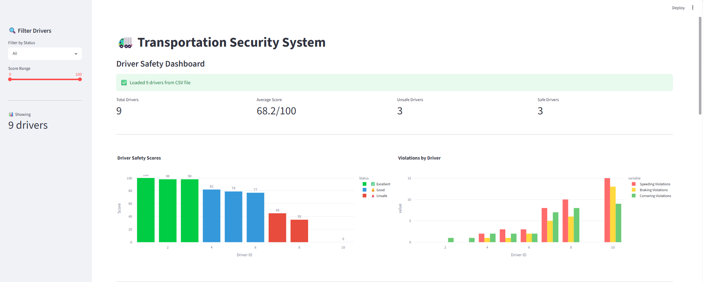
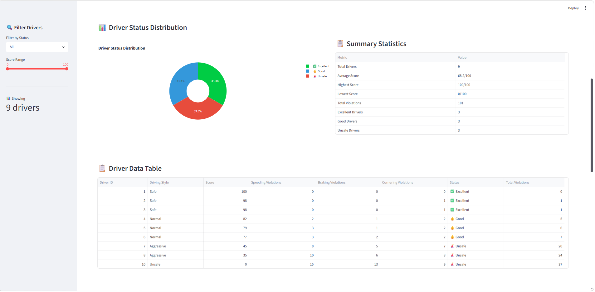
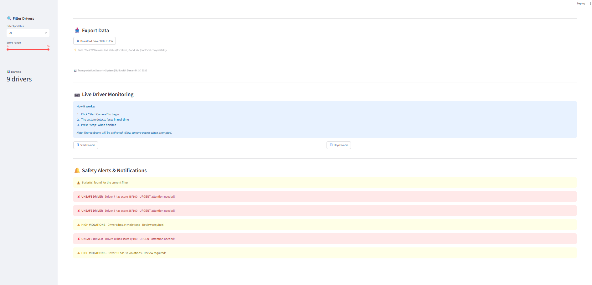

# Transportation Security System


## Table of Contents
- [Overview](#-overview)
- [Business Problem](#-business-problem)
- [Dataset](#-dataset)
- [Technology Stack](#-technologies--libraries)
- [Project Structure](#-project-structure)
- [What Each Phase Contains](#-what-each-phase-contains)
- [Key Findings](#-key-findings--insights)
- [Dashboard](#-dashboard-screenshots)
- [Installation](#-installation--usage)
- [Recommendations](#-recommendations)
- [Skills Demonstrated](#-skills-demonstrated)
- [Author](#-author)
- [License](#-license)

---

## 🌍 Overview

The **Transportation Security System** is a prototype that demonstrates driver-behaviour analytics and basic face detection using synthetic data and sample images. It is not a validated accident-prevention or production fatigue-monitoring system. It includes a threshold-based behaviour analyser, a Streamlit dashboard, a face-detection snapshot and an exploratory EAR notebook. It currently does not ingest live vehicle telemetry, integrate fatigue detection into the dashboard, or demonstrate reduced accident rates.

**Current prototype capabilities:**
- ✅ Face detection on a user-provided image or browser camera snapshot
- ⚠️ EAR-based fatigue detection demonstrated in a notebook; not integrated into the dashboard or validated for operational use
- ✅ Speeding, harsh braking, and harsh cornering detection
- ✅ Driver scorecards (0-100 rating system)
- ✅ Interactive dashboard with filters and alerts
- ✅ Export data to CSV (Excel compatible)
- ✅ Browser camera snapshot with face detection (not continuous video monitoring)
- ✅ Safety notifications and alerts
---

## 📋 Business Problem

Road safety is a major transport-sector concern. The figures below should be sourced to current WHO publications before external publication; this prototype does not independently validate those statistics.

**The transportation industry faces important safety challenges:**

| Challenge | Impact |
|-----------|--------|
| Driver Fatigue | 20-30% of all road accidents |
| Distracted Driving | 25% of all traffic accidents |
| Speeding | 30% of fatal accidents |
| Harsh Braking | Increased vehicle wear, passenger discomfort |
| Lack of Real-time Monitoring | Delayed incident response |

**This prototype explores these challenges by:**
- Exploring eye-closure measurements with an EAR notebook (not validated for fatigue diagnosis)
- Summarising synthetic driving-behaviour events with threshold-based rules
- Providing actionable feedback to drivers and fleet managers
- Creating a safety scorecard for driver performance tracking

---

## 📊 Dataset

This project uses **synthetic (generated) data** for demonstration purposes. 
Potential future integrations (not currently implemented) include:
- GPS modules for speed and location tracking
- Accelerometers for braking and cornering detection
- Cameras for driver face monitoring
- OBD-II ports for vehicle health data

The generator and scorecard pipeline can be extended to real inputs, but live sensor integration is not implemented.

### Data Generated:

| Data Type | Description | Source |
|-----------|-------------|--------|
| GPS Data | Speed, latitude, longitude | Synthetic generator |
| Sensor Data | Acceleration, braking, cornering | Synthetic generator |
| Driver Data | 9 drivers with different driving styles | Synthetic generator |
| Face Images | Test images for face detection | Downloaded samples |

### Example driver profiles

The scorecard is a small, manually defined synthetic demonstration dataset. Driving-style labels are illustrative; scores are calculated from the violation counts using the same documented formula.

### Sample Data:
Driver ID | Style | Score | Speeding | Braking | Cornering
1 | Safe | 100 | 0 | 0 | 0
2 | Safe | 98 | 0 | 0 | 1
3 | Safe | 98 | 0 | 0 | 1
4 | Normal | 83 | 2 | 1 | 2
5 | Normal | 78 | 3 | 1 | 2
6 | Normal | 75 | 3 | 2 | 2
7 | Aggressive | 31 | 8 | 5 | 7
8 | Aggressive | 16 | 10 | 6 | 8
10 | Unsafe | 0 | 15 | 13 | 9


---

## 🛠 Technologies & Libraries

| Category | Technology | Version | Purpose |
|----------|------------|---------|---------|
| **Programming** | Python | 3.10+ | Core development |
| **Computer Vision** | OpenCV, dlib | See requirements.txt | Face detection and optional facial landmarks |
| **Dashboard** | Streamlit | See requirements.txt | Web interface |
| **Visualization** | Plotly | See requirements.txt | Interactive charts |
| **Data Analysis** | Pandas | 2.0.0+ | Data manipulation |
| **Numerical** | NumPy | 1.24.3 | Mathematical operations |
| **Visualization** | Matplotlib | 3.7.0+ | Data visualization |
| **Machine Learning** | Scikit-learn | 1.2.0+ | ML utilities |

---

## 📁 Project Structure

## Project Structure

```
02_Transportation_Security_System/
│
├── Dashboard.py                    # Main Streamlit dashboard
├── requirements.txt                # Python dependencies
├── .gitignore                      # Git ignore file
├── .dockerignore                   # Docker build exclusions
├── Dockerfile                      # Container definition
├── README.md                       # Project documentation
│
├── config/
│   └── config.yaml                 # Configuration settings
│
├── data/
│   ├── raw/
│   │   └── driver_data_raw.csv     # Raw driver data
│   └── processed/
│       └── driver_data_processed.csv # Processed data
│
├── images/
│   ├── dashboard_top.png
│   ├── dashboard_middle.png
│   └── dashboard_bottom.png
│
├── notebooks/
│   ├── 01_Synthetic_data_generation.ipynb
│   ├── 02_Face_Detection.ipynb
│   ├── 03_Fatigue_Detection.ipynb
│   └── 04_Behavior_Analysis.ipynb
│
├── scripts/
│   └── verify_data.py              # Validates scorecard totals and scores
│
├── src/
│   ├── __init__.py
│   ├── data_collection/
│   │   └── data_generator.py       # Data generation
│   ├── driver_monitoring/
│   │   └── face_detection.py       # Face detection
│   ├── behavior_analysis/
│   │   └── behavior_analyzer.py    # Behavior analysis
│
└── tests/
    └── test_data_generator.py      # Unit tests
```
---

## 📊 What Each Phase Contains

### Phase 1: Synthetic Data Generation
**Notebook:** `01_Synthetic_data_generation.ipynb`

| Component | Description |
|-----------|-------------|
| GPS Data Generation | Speed, latitude, longitude simulation |
| Sensor Data Generation | Acceleration, braking data |
| Data Exploration | Summary statistics and visualization |
| Data Export | Save to CSV format |

**Key Concepts Learned:**
- Data simulation techniques
- Pandas and NumPy for data manipulation
- Matplotlib for visualization

---

### Phase 2: Face Detection
**Notebook:** `02_Face_Detection.ipynb`

| Component | Description |
|-----------|-------------|
| OpenCV Face Detection | Haar Cascade classifier |
| dlib Face Detection | HOG + SVM detector |
| Facial Landmarks | 68-point facial landmark extraction |
| Detection Comparison | Compare both methods |

**Key Concepts Learned:**
- Face detection algorithms
- Facial landmark detection
- OpenCV and dlib integration

---

### Phase 3: Fatigue Detection
**Notebook:** `03_Fatigue_Detection.ipynb`

| Component | Description |
|-----------|-------------|
| Eye Aspect Ratio (EAR) | Mathematical formula for eye closure |
| Left/Right Eye Extraction | Point extraction from landmarks |
| Fatigue Detection | EAR threshold algorithm |

**Key Concepts Learned:**
- Eye Aspect Ratio calculation
- Real-time eye tracking
- Fatigue detection logic

**EAR Formula:**
EAR = (A + B) / (2 * C)
- EAR < 0.25 = Eye closed (fatigue detected)
- EAR > 0.25 = Eye open (normal)

---

### Phase 4: Behavior Analysis
**Notebook:** `04_Behavior_Analysis.ipynb`

| Component | Description |
|-----------|-------------|
| Speeding Detection | Speed > limit + 10% |
| Harsh Braking Detection | Deceleration > 3 m/s² |
| Harsh Cornering Detection | Lateral acceleration > 2 m/s² |
| Driver Scorecard | 0-100 scoring system |
| Multi-Driver Comparison | 9 drivers analyzed |

**Key Concepts Learned:**
- Threshold-based detection
- Driver performance metrics
- Scorecard calculation

---

### Phase 5: Dashboard
**File:** `Dashboard.py`

| Component | Description |
|-----------|-------------|
| Key Metrics | Total drivers, average score, unsafe count |
| Driver Score Chart | Bar chart with color coding |
| Violations Chart | Speeding, braking, cornering breakdown |
| Data Table | Complete driver data display |
| CSV Data Loading | Persistent data storage |

**Key Concepts Learned:**
- Web application development with Streamlit
- Interactive data visualization with Plotly
- Real-time dashboard design

---

## 📈 Key Findings & Insights

### Driver Distribution

| Category | Count | Percentage |
|----------|-------|------------|
| ⭐ Excellent (90-100) | 3 | 33.3% |
| 👍 Good (70-89) | 3 | 33.3% |
| 🚨 Unsafe (<50) | 3 | 33.3% |

### Score Statistics

| Metric | Value |
|--------|-------|
| Total Drivers | 9 |
| Average Score | 64.3/100 |
| Highest Score | 100/100 |
| Lowest Score | 0/100 |
| Total Violations | 101 |

### Violation Breakdown

| Violation Type | Total Count |
|----------------|-------------|
| Speeding | 41 |
| Harsh Braking | 28 |
| Harsh Cornering | 32 |
| **Total** | **101** |

### Key Insight
**33.3% of the synthetic sample is classified as unsafe by the demonstration scoring rules. This is not a real-fleet estimate or a validated safety conclusion.**

---

## Dashboard Screenshots
### Metrics & Charts

*Key metrics and driver score/violations charts*

### Status Distribution & Data Table

*Driver status distribution and complete data table*

### Export, Camera Snapshot & Alerts

*CSV export, browser camera snapshot with face detection, and safety alerts*

---

*Full dashboard available when you run: `streamlit run Dashboard.py`*

---


## 🎛️ Dashboard Features

### Interactive Filters
- Status filter (All, Excellent, Good, Unsafe)
- Score range slider (0-100)
- Real-time updates

### Export Data
- Download filtered data as CSV
- Excel compatible format

### Camera Snapshot Face Detection
- Uses the browser camera through Streamlit
- Detects faces in a captured snapshot and draws a green box
- Non-blocking; does not claim continuous live monitoring or fatigue detection

### Safety Alerts
- Unsafe driver alerts (score < 50)
- High violation alerts (> 20 violations)
- Color-coded notifications


> **Screenshot note:** The committed screenshots were captured before the scorecard corrections and are now stale. Regenerate them by running the dashboard before using them as evidence of the current output.

### Key Metrics Overview


| Metric | Value |
|--------|-------|
| **Total Drivers** | 9 |
| **Average Score** | 64.3/100 |
| **Highest Score** | 100/100 |
| **Lowest Score** | 0/100 |
| **Unsafe Drivers** | 3 |
| **Total Violations** | 101 |

### Score Distribution

| Score Range | Status | Count |
|-------------|--------|-------|
| 90-100 | ⭐ Excellent | 3 |
| 70-89 | 👍 Good | 3 |
| 0-49 | 🚨 Unsafe | 3 |


### Driver Score Chart
- Bar chart showing all 9 drivers with scores
- Color-coded: Green (Excellent), Blue (Good), Red (Unsafe)
- Score labels displayed on each bar

### Violations Breakdown
- Grouped bar chart showing Speeding, Braking, Cornering
- Clear visualization of each driver's violation patterns

---

## 🚀 Installation & Usage

### Prerequisites

| Requirement | Version |
|-------------|---------|
| Python | 3.10+ |
| Git | Latest |
| VS Code (recommended) | Latest |

### Step 1: Clone the Repository

```bash
git clone https://github.com/SimbarasheChindanga/transportation-security-system.git
cd transportation-security-system
```

###  Step 2: Create Virtual Environment
```bash
# Windows
python -m venv .venv
.venv\Scripts\activate

# Linux/Mac
python -m venv .venv
source .venv/bin/activate
```

### Step 3: Install Dependencies
```bash
python -m pip install --upgrade pip
pip install -r requirements.txt
```

### Step 4: Verify Data and Tests
```bash
python scripts/verify_data.py
python -m pytest -q
```

### Step 5: Run the Dashboard
```bash
streamlit run Dashboard.py
```

### Step 6: Open in Browser
Your browser will open automatically at:
http://localhost:8501

### Alternative: Run Jupyter Notebooks
```bash
jupyter notebook
```
Then open any notebook in the notebooks/ folder.


> **Evidence limitation:** All driver scorecards are synthetic demonstration data. These figures are not observed fleet safety outcomes. Face detection and EAR calculations are prototypes; fatigue detection is not integrated into the dashboard or validated for operational use.

## 💡 Recommendations

| Recommendation | Implementation | Expected Impact |
|----------------|----------------|-----------------|
| Identify Unsafe Drivers | Use driver scorecards (0-100) | Target training for low performers |
| Monitor Violation Patterns | Track speeding, braking, cornering | Evaluate safety outcomes in a future real-world pilot |
| Implement Safety Training | Focus on aggressive drivers | Improve overall safety scores |
| Reward Safe Drivers | Recognize high performers | Encourage safe driving culture |

## For System Improvements

Improvement	Description	Priority
Real-time Monitoring	Connect to live GPS/telemetry data	High
Mobile App	Driver notifications and feedback	Medium
Advanced Fatigue Models	TensorFlow deep learning models	Medium
API Integration	Connect with fleet management systems	Low


## 🏆 Skills Demonstrated

## Technical Skills

Skill	Project Application
Python Programming	All backend code
Computer Vision	OpenCV, dlib for face detection
Data Analytics	Pandas, NumPy for data analysis
Web Development	Streamlit dashboard
Data Visualization	Plotly, Matplotlib charts
Computer Vision	OpenCV/dlib face detection; EAR notebook prototype (not validated)
Data Handling	CSV-based synthetic demonstration data
Version Control	Git and GitHub
Testing	Pytest unit tests for generation, scoring and threshold rules

## Soft Skills

Skill	How Demonstrated
Problem Solving	Breaking down complex safety problems
Project Management	Structured 5-phase development
Documentation	README, code comments, proposals
Self-Learning	New technologies (OpenCV, dlib, Streamlit)
Communication	Clear project presentation

## 👤 Author

**Simbarashe Chindanga**

Role: Transport Technology Specialist

Focus: Supply Chain Visibility, Data Analytics, Full-Stack Development

Location: Zimbabwe 🇿🇼

- 💼 Portfolio: https://github.com/SimbarasheChindanga
- 📧 Email: chindangasimbarashe02@gmail.com
- 🐙 GitHub: https://github.com/SimbarasheChindanga


## 📄 License
No open-source license has been specified for this project.

