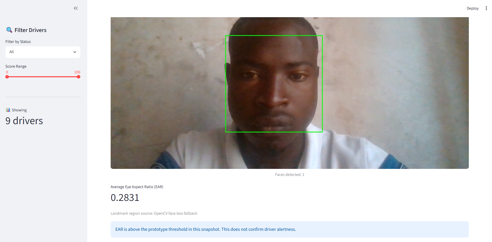
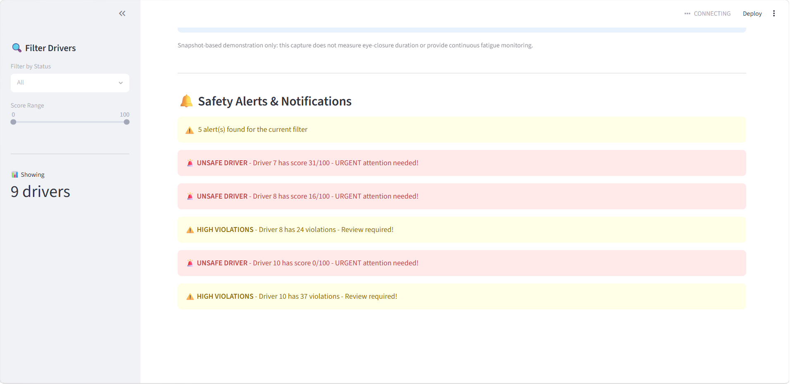

# Transportation Security System


## Table of Contents 
- [Overview](#-overview)
- [Business Problem](#-business-problem)
- [Dataset](#-dataset)
- [Technology Stack](#-technologies--libraries)
- [Project Structure](#-project-structure)
- [What Each Phase Contains](#-what-each-phase-contains)
- [Key Findings](#-key-findings--insights)
- [Dashboard](#-dashboard-screenshots)
- [Installation](#-installation--usage)
- [Recommendations](#-recommendations)
- [Skills Demonstrated](#-skills-demonstrated)
- [Author](#-author)
- [License](#-license)

---

## 🌍 Overview

The **Transportation Security System** is a portfolio prototype exploring how data analytics and computer vision can support driver-safety workflows. It combines a Streamlit dashboard for driver-scorecard analysis with rule-based driving-behaviour metrics, face detection, and a preliminary Eye Aspect Ratio (EAR) calculation from a submitted camera snapshot.

This project is a demonstration and learning tool. It has **not** been validated for operational driver monitoring, clinical fatigue detection, accident prevention, or real-world safety decisions.

**Current capabilities:**
- ✅ Interactive driver scorecards and safety metrics
- ✅ Filters for driver status and score range
- ✅ Rule-based speeding, harsh-braking, and harsh-cornering counts
- ✅ Driver behaviour scores calculated from configurable penalties
- ✅ CSV export of filtered driver records
- ✅ Face detection on an image captured with Streamlit's browser camera widget
- ✅ EAR calculation from facial landmarks for a single submitted snapshot
- ✅ Preliminary low-EAR message when a snapshot is below the configured threshold
- ✅ Exploratory Jupyter notebooks for synthetic data, face detection, EAR, and behaviour analysis

**Scope note:** the current dashboard uses `st.camera_input`, which captures a still image. It does not perform continuous webcam tracking or accumulate eye-closure duration across video frames. A low EAR value is a heuristic signal, not proof of fatigue.

---

## 📋 Business Problem

Transport operators need ways to review driver performance, identify patterns in reported driving events, and explore driver-monitoring concepts. This project demonstrates a simple workflow for reviewing sample driver records and experimenting with computer-vision measurements.

| Challenge | How this prototype explores it |
|-----------|---------------------------------|
| Driver performance review | Driver scorecards, summary metrics, and filters |
| Unsafe driving-event patterns | Rule-based speeding, braking, and cornering counts |
| Driver-monitoring concepts | Face detection and EAR measurement from a snapshot |
| Reporting and follow-up | CSV export and dashboard alerts based on sample scores |

The project does not establish that these prototype features reduce crashes or detect unsafe driving reliably. Operational use would require suitable real-world data, validation, privacy safeguards, and testing under realistic driving conditions.

---

## 📊 Dataset

The dashboard uses **synthetic/sample driver records** for demonstration. The included CSV files do not represent an identified real-world fleet, and they should not be used to estimate accident rates or prove the effectiveness of a safety intervention.

The codebase also contains a synthetic-data generation notebook and a data generator. GPS, accelerometer, vehicle telemetry, and camera feeds are not connected as live data sources in the current dashboard.

### Driver styles represented

| Style | Example interpretation |
|-------|------------------------|
| Safe | Few or no recorded violations in the sample |
| Normal | A moderate number of recorded violations in the sample |
| Aggressive | Higher counts of recorded violations in the sample |
| Unsafe | High counts of recorded violations in the sample |

These style labels are descriptive categories in the sample data, not independently validated driving classifications.

### Sample Data

The processed sample dataset contains nine driver records.

| Driver ID | Driving Style | Score | Speeding | Braking | Cornering | Status | Total Violations |
|---:|---|---:|---:|---:|---:|---|---:|
| 1 | Safe | 100 | 0 | 0 | 0 | Excellent | 0 |
| 2 | Safe | 98 | 0 | 0 | 1 | Excellent | 1 |
| 3 | Safe | 98 | 0 | 0 | 1 | Excellent | 1 |
| 4 | Normal | 83 | 2 | 1 | 2 | Good | 5 |
| 5 | Normal | 78 | 3 | 1 | 2 | Good | 6 |
| 6 | Normal | 75 | 3 | 2 | 2 | Good | 7 |
| 7 | Aggressive | 31 | 8 | 5 | 7 | Unsafe | 20 |
| 8 | Aggressive | 16 | 10 | 6 | 8 | Unsafe | 24 |
| 10 | Unsafe | 0 | 15 | 13 | 9 | Unsafe | 37 |
## 🛠 Technologies & Libraries

| Category | Technology | Purpose in this project |
|----------|------------|-------------------------|
| Programming | Python 3.10+ | Application and analysis code |
| Computer vision | OpenCV | Image handling and Haar-cascade face detection |
| Facial landmarks | dlib and 68-point predictor | Facial landmark extraction for EAR calculation |
| Dashboard | Streamlit | Interactive local web interface and camera snapshot input |
| Visualization | Plotly | Interactive charts |
| Data analysis | pandas, NumPy | Tabular data handling and numerical operations |
| Scientific utilities | SciPy, scikit-learn | Analysis and notebook dependencies |
| Visualization/notebooks | Matplotlib, Seaborn, Jupyter | Exploratory analysis and plots |
| Testing | pytest | Automated project tests |

Package versions are controlled by the ranges in `requirements.txt`; exact versions vary by environment. TensorFlow-based fatigue-model training and production database/IoT integrations are **not implemented features** of the current dashboard.

---

## 📁 Project Structure

```text
02_Transportation_Security_System/
│
├── Dashboard.py                         # Main Streamlit dashboard
├── requirements.txt                     # Python dependencies
├── README.md                            # Project documentation
├── .gitignore                           # Git ignore rules
│
├── config/
│   └── config.yaml                      # Configuration settings
│
├── data/
│   ├── raw/
│   │   └── driver_data_raw.csv          # Sample driver data
│   └── processed/
│       └── driver_data_processed.csv    # Dashboard input data
│
├── images/
│   ├── dashboard_top.png               # Main metrics and charts
│   ├── dashboard_middle.png            # Status distribution and data table
│   └── dashboard_bottom.png            # Export, camera, and alerts
│
├── notebooks/
│   ├── 01_Synthetic_data_generation.ipynb
│   ├── 02_ Face_Detection.ipynb
│   ├── 03_Fatigue_Detection.ipynb
│   ├── 04_Behavior_Analysis.ipynb
│   ├── lena.jpg                         # Face-detection test image
│   └── shape_predictor_68_face_landmarks.dat  # Local landmark model, if installed
│
├── src/
│   ├── data_collection/
│   │   └── data_generator.py
│   ├── behavior_analysis/
│   │   └── behavior_analyzer.py
│   └── driver_monitoring/
│       ├── face_detection.py
│       └── fatigue_detection.py
│
└── tests/
    └── test_data_generator.py
```

The tree lists the principal files for the current working version. Local caches, test artifacts, optional model files, and development-only files may also be present. The landmark model is a large external asset; see the setup instructions below if it is missing locally.

---

## 📊 What Each Phase Contains

### Phase 1: Synthetic Data Generation
**Notebook:** `01_Synthetic_data_generation.ipynb`

| Component | Description |
|-----------|-------------|
| Sample data generation | Generate driver-style and event data for exploration |
| Data exploration | Inspect summary statistics and distributions |
| Data export | Save records to CSV for dashboard use |

**Key concepts:** synthetic-data generation, pandas/NumPy operations, and exploratory visualization.

### Phase 2: Face Detection
**Notebook:** `02_ Face_Detection.ipynb`

| Component | Description |
|-----------|-------------|
| OpenCV face detection | Haar Cascade face-box detection |
| dlib face detection | HOG-based face detector |
| Facial landmarks | 68-point landmark extraction where a face rectangle can be supplied |
| Detector comparison | Experiment with alternate detection approaches |

**Key concepts:** face detection, facial landmarks, and OpenCV/dlib integration.

### Phase 3: Fatigue Detection Prototype
**Notebook:** `03_Fatigue_Detection.ipynb`

| Component | Description |
|-----------|-------------|
| Eye Aspect Ratio (EAR) | Calculate a ratio from eye landmarks |
| Left/right eye extraction | Use landmark points 36–41 and 42–47 |
| Low-EAR heuristic | Flag a single image when the average EAR is below the configured threshold |
| Dashboard integration | Display the snapshot EAR measurement and a preliminary message |

The default prototype threshold is `0.25`. This is a heuristic, not a validated fatigue threshold. The current dashboard uses a single snapshot and does not measure closure duration across continuous video frames.

**EAR formula:**

`EAR = (A + B) / (2 * C)`

where `A` and `B` are vertical eye-landmark distances and `C` is the horizontal distance between eye corners.

### Phase 4: Behaviour Analysis
**Module:** `src/behavior_analysis/behavior_analyzer.py`

| Component | Description |
|-----------|-------------|
| Speeding event detection | Flag speed greater than 110% of the configured speed limit |
| Harsh-braking detection | Compare longitudinal acceleration with the configured threshold |
| Harsh-cornering detection | Compare absolute lateral acceleration with the configured threshold |
| Driver scorecard | Apply rule-based penalties to a 0–100 score |

The current demonstration scoring starts at 100 and subtracts 5 points per speeding event, 3 per harsh-braking event, and 2 per harsh-cornering event. The result is clamped to the range 0–100. These are example rules, not a calibrated transport-safety standard.

### Phase 5: Dashboard
**File:** `Dashboard.py`

| Component | Description |
|-----------|-------------|
| Key metrics | Driver count, average score, and status counts |
| Driver score chart | Bar chart with score/status coloring |
| Violations chart | Compare speeding, braking, and cornering counts |
| Data table | Display driver records |
| Export | Download filtered records as CSV |
| Camera snapshot | Capture an image, display face detection, and calculate EAR where possible |
| Safety alerts | Show rule-based alerts derived from sample driver scores and event counts |

The dashboard is a local portfolio demonstration, not a continuous video-monitoring application.

---

## 📈 Key Findings & Insights

The figures below are calculated from the included `data/processed/driver_data_processed.csv` sample file.

### Driver distribution

| Category | Count | Percentage |
|----------|------:|-----------:|
| ⭐ Excellent (score 90–100) | 3 | 33.3% |
| 👍 Good (score 70–89) | 3 | 33.3% |
| ⚠️ Needs Improvement (score 50–69) | 0 | 0.0% |
| 🚨 Unsafe (score below 50) | 3 | 33.3% |

### Score statistics

| Metric | Value |
|--------|------:|
| Total driver records | 9 |
| Average score | 68.2 / 100 |
| Highest score | 100 / 100 |
| Lowest score | 0 / 100 |
| Total recorded violations | 101 |

### Violation breakdown

| Violation type | Total count |
|----------------|------------:|
| Speeding | 41 |
| Harsh braking | 28 |
| Harsh cornering | 32 |
| **Total** | **101** |

**Interpretation:** in this sample, three records fall into the dashboard's unsafe score category. These are synthetic/sample records, so the distribution is descriptive of the file only; it is not evidence about a real fleet or the impact of a safety intervention.

---

## 📊 Dashboard Screenshots

### Metrics & charts


*Key metrics and driver score/violation charts.*

### Status distribution & data table


*Driver status distribution and driver data table.*


### Camera Snapshot Interface



### Safety Alerts & Notifications



*Example safety alerts showing driver scores and violation warnings.*


*CSV export, camera snapshot, and safety alerts.*

Run `streamlit run Dashboard.py` to open the local dashboard.

---

## 🎛️ Dashboard Features

### Interactive filters
- Filter driver records by status.
- Filter scores using the 0–100 score-range slider.
- Update dashboard charts and tables based on the selected filters.

### Export data
- Download the currently filtered driver table as CSV.
- The export uses UTF-8 with a byte-order mark for compatibility with spreadsheet applications.

### Camera snapshot and EAR demonstration
- Enable the optional camera widget and take a snapshot.
- Display the selected OpenCV face box where detection succeeds.
- Calculate an EAR value when facial landmarks can be extracted.
- Display a preliminary low-EAR message when the result is below the prototype threshold.

**Limitation:** this is snapshot-based. It does not provide continuous live face tracking, count eye-closure duration, or establish that a driver is fatigued or alert.

### Safety alerts
- Unsafe driver alert when score is below 50.
- High-violation alert when recorded violations exceed 20.
- Needs-improvement alert when a score is from 50 to 69.

These are configurable demonstration rules, not real-time safety interventions.

---

## 🚀 Installation & Usage

### Prerequisites

| Requirement | Version/notes |
|-------------|---------------|
| Python | 3.10+ recommended for the current project setup |
| Git | Required only to clone the repository |
| VS Code | Optional, recommended for editing |
| Browser camera permission | Needed only to test the snapshot feature |

### Step 1: Clone the repository

```bash
git clone https://github.com/SimbarasheChindanga/transportation-security-system.git
cd transportation-security-system
```

### Step 2: Create a virtual environment

**Windows PowerShell:**

```powershell
py -3.10 -m venv .venv
.\.venv\Scripts\Activate.ps1
```

**Linux/macOS:**

```bash
python3 -m venv .venv
source .venv/bin/activate
```

### Step 3: Install dependencies

```bash
python -m pip install --upgrade pip
python -m pip install -r requirements.txt
python -m pip install pytest
```

If the `dlib-bin` dependency cannot be installed in your environment, use a compatible Python/package build or consult the package's installation guidance for your platform.

### Step 4: Check the facial landmark model

The face detector expects the landmark file at:

`notebooks/shape_predictor_68_face_landmarks.dat`

If it is missing, download the compressed model from the [official dlib model URL](https://dlib.net/files/shape_predictor_68_face_landmarks.dat.bz2) and save it as `notebooks/shape_predictor_68_face_landmarks.dat.bz2`. From the project root, extract it with:

```bash
python -c "import bz2; from pathlib import Path; src=Path('notebooks/shape_predictor_68_face_landmarks.dat.bz2'); dst=Path('notebooks/shape_predictor_68_face_landmarks.dat'); dst.write_bytes(bz2.decompress(src.read_bytes())); print('Extracted:', dst, dst.stat().st_size, 'bytes')"
```

Use only a completed, intact archive. The uncompressed model is large; avoid committing it to Git unless you have a deliberate reason and have checked repository size limits and licensing/redistribution terms.

### Step 5: Run the dashboard

```bash
streamlit run Dashboard.py
```

Open the local address printed by Streamlit (usually `http://localhost:8501`). The app loads `data/processed/driver_data_processed.csv` when available and has fallback sample records if the file is absent.

### Step 6: Run tests and a syntax check

```bash
python -m pytest -q
python -m py_compile Dashboard.py
```

Run these commands in the same environment used by the dashboard. A successful syntax check confirms Python syntax only; it does not validate camera performance or fatigue-classification accuracy.

### Step 7: Open the notebooks

```bash
python -m pip install jupyter
jupyter notebook
```

Open a notebook from the `notebooks/` directory. Notebook outputs and requirements may vary with the installed environment.

---

## 💡 Recommendations

| Recommendation | Possible implementation | Intended value (not guaranteed) |
|----------------|-------------------------|----------------------------------|
| Review low-scoring sample records | Use scorecards and violation counts | Help demonstrate where review or training might be targeted |
| Compare violation patterns | Review speeding, braking, and cornering counts | Make sample event patterns easier to interpret |
| Evaluate the EAR prototype | Test multiple images and lighting/camera positions | Understand measurement limitations before any deployment |
| Add temporal monitoring | Build and validate continuous frame processing with elapsed-time tracking | Support future experiments with prolonged eye closure |
| Integrate real telemetry | Add documented, consented GPS/vehicle data sources | Move beyond synthetic demonstration data |

## For system improvements

| Improvement | Description | Priority |
|-------------|-------------|----------|
| Continuous monitoring | Implement persistent video-frame processing and test frame timing | High |
| Temporal fatigue indicator | Evaluate eye closure over elapsed time rather than a single snapshot | High |
| Data validation | Check schemas, missing values, and expected ranges | High |
| Fleet-system integration | Add APIs or approved telemetry sources when available | Medium |
| Deployment hardening | Add privacy controls, logging, monitoring, and environment configuration | Medium |

---

## 🏆 Skills Demonstrated

### Technical skills

| Skill | Project application |
|-------|---------------------|
| Python programming | Dashboard and reusable analysis modules |
| Computer vision | OpenCV and dlib face/landmark processing |
| Data analytics | pandas/NumPy operations and summary metrics |
| Data visualization | Streamlit and Plotly dashboard charts |
| Rule-based analysis | Threshold-based event counts and scorecard penalties |
| Documentation | Project README, setup instructions, and notebooks |
| Version control | Git and GitHub repository workflow |
| Testing | pytest-based automated tests and manual feature checks |

### Professional focus

This project supports a portfolio focused on **transport technology, fleet analytics, and logistics systems**. It is a demonstration of technical workflow and should not be presented as a validated commercial driver-safety product.

---

## 👤 Author

**Simbarashe Chindanga**

**Role:** Transport Technology Specialist  
**Focus:** Supply Chain Visibility, Data Analytics, Full-Stack Development  
**Location:** Zimbabwe 🇿🇼

- 💼 Portfolio: https://github.com/SimbarasheChindanga
- 📧 Email: [chindangasimbarashe02@gmail.com](mailto:chindangasimbarashe02@gmail.com)
- 🐙 GitHub: https://github.com/SimbarasheChindanga

Related portfolio projects:
- [Fleet Performance Analysis](https://github.com/SimbarasheChindanga/fleet_performance_analysis)
- [Transportation Security System](https://github.com/SimbarasheChindanga/transportation-security-system)
- [Supply Chain Visibility Platform](https://github.com/SimbarasheChindanga/supply-chain-visibility-platform)

---

## 📄 License

The original README described this project as MIT-licensed, but a separate `LICENSE` file was not present in the project snapshot reviewed. Before publishing the repository as MIT-licensed, add the appropriate `LICENSE` file to the repository. Until then, the license status should be treated as **not specified**.
